# ROADLINE '91

A point-to-point racing game for the browser in the style of the early polygon racers of around 1990. Flat-shaded polygons, a 320×200 picture in which every pixel is an index into a 256-color palette, Bayer dithering, FM-synthesis music. Pure JavaScript and WebGL2: no libraries, no build dependencies, no image or audio files.

**▶ Play: https://noneawe.github.io/roadline91/**

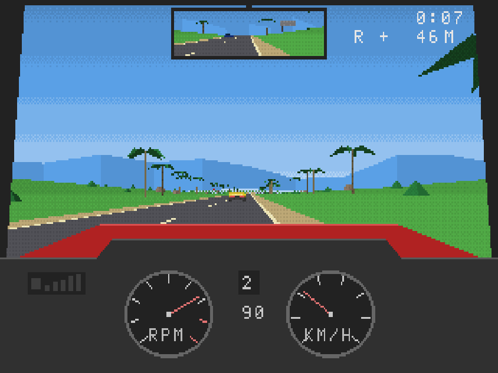

## Screenshots

| | |
|---|---|
| 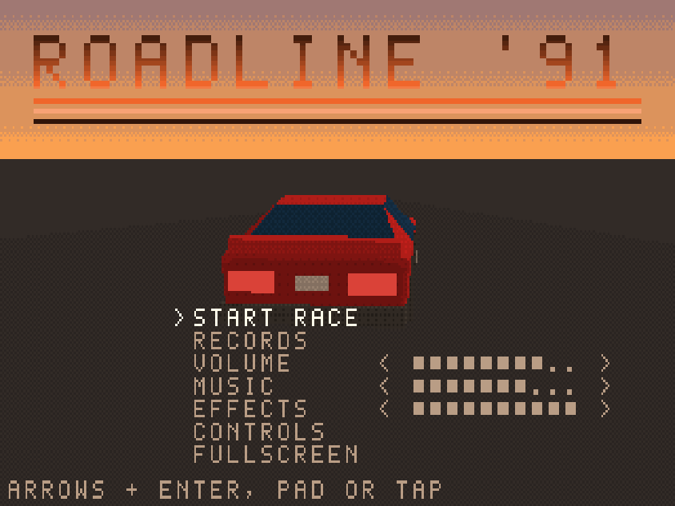 | 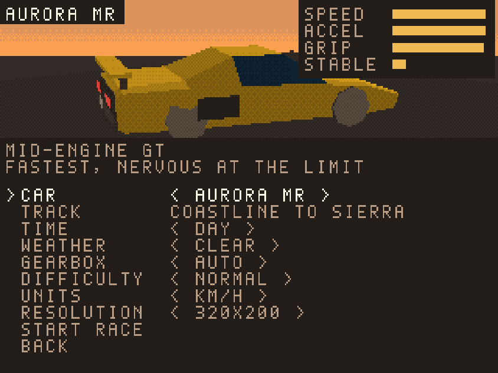 |
| Title screen with palette color cycling | Four fictional cars, each with its own character |
| 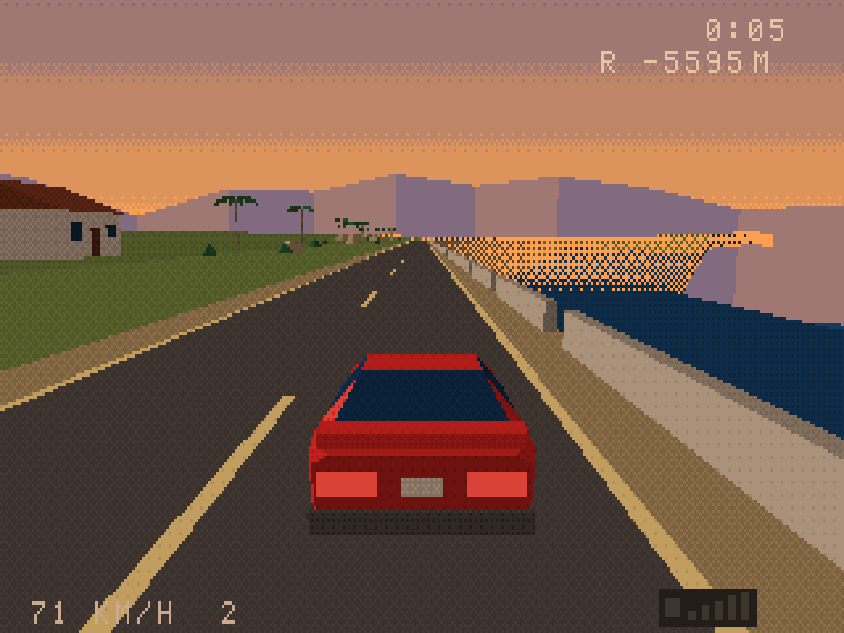 | 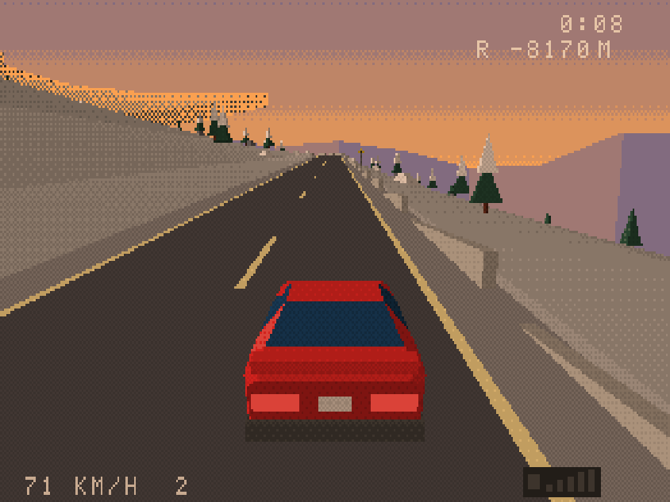 |
| Sea cliff and lighthouse at sunset | Mountain pass with hairpins above a drop |
| 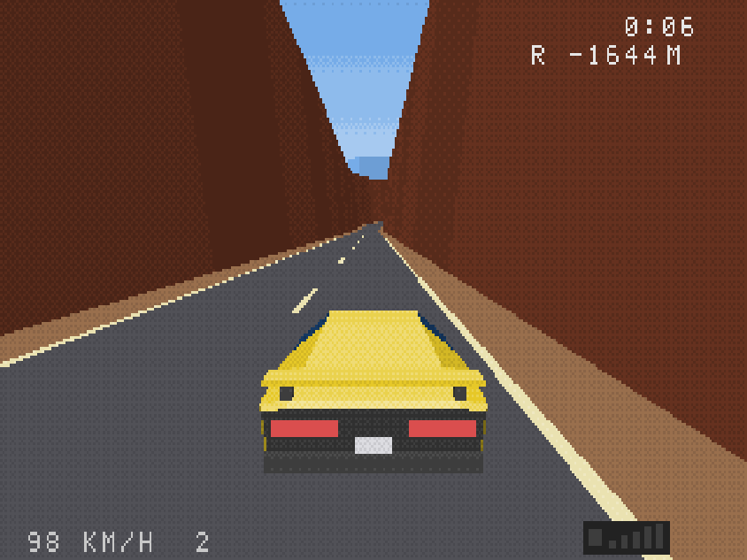 | 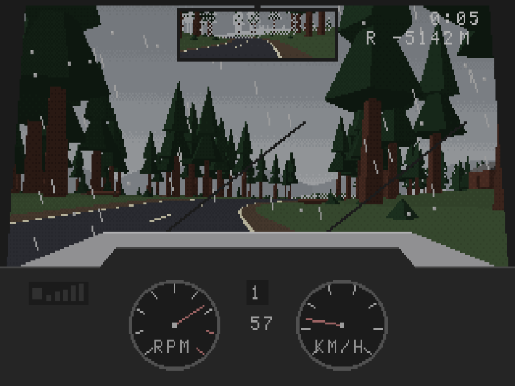 |
| Red-rock canyon | Rain: wipers, drops, wet asphalt |
| 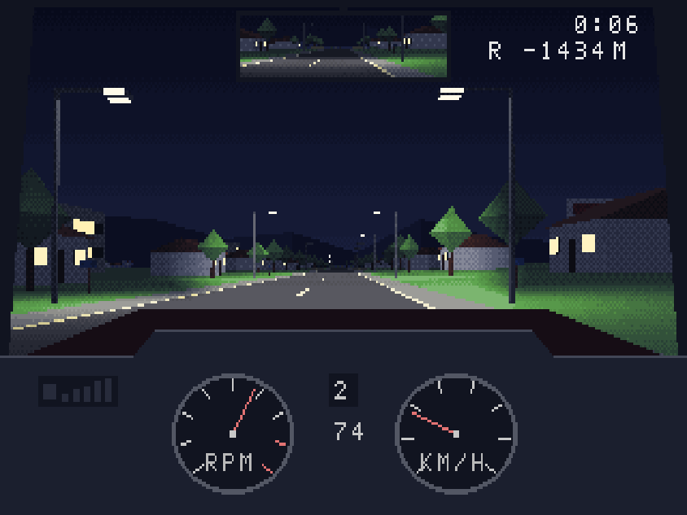 | 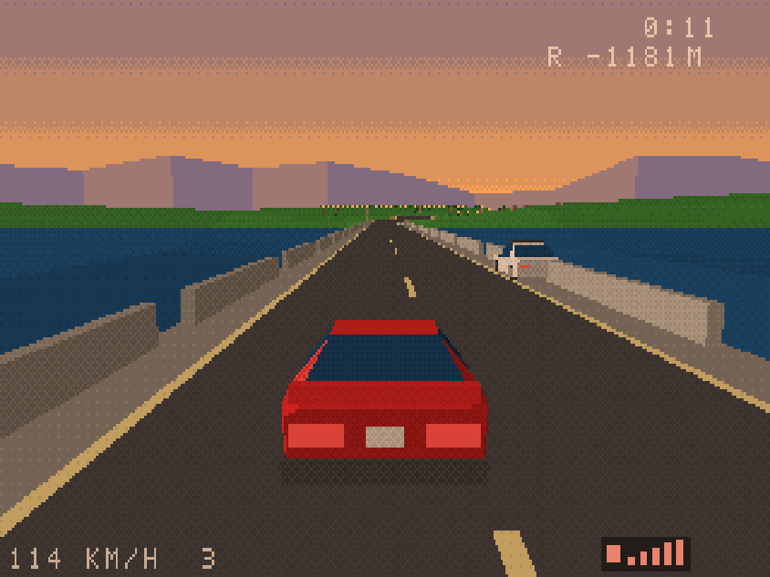 |
| Night with a dithered headlight wedge | Radar trap and chase |
| 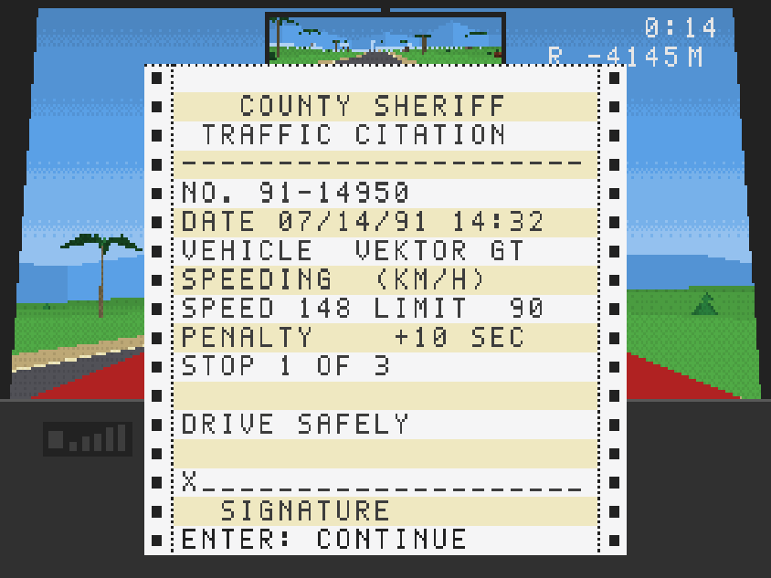 | 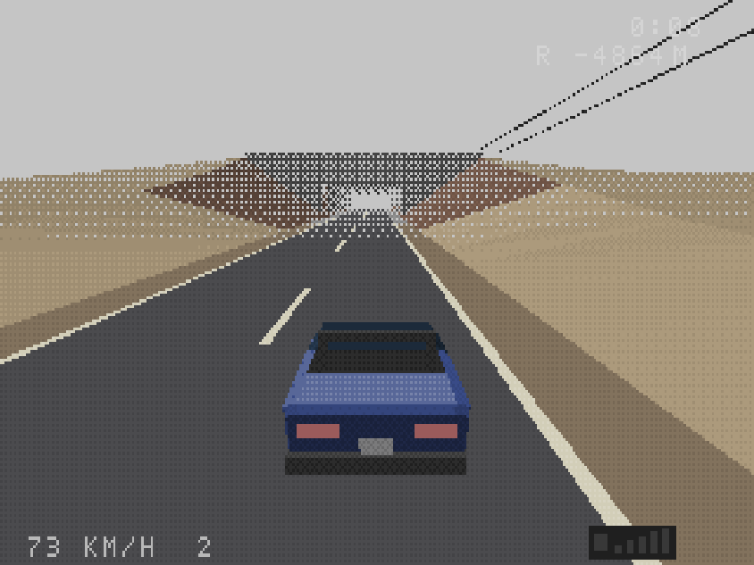 |
| Citation printed like a dot-matrix printout | Fog done with dithering |
| 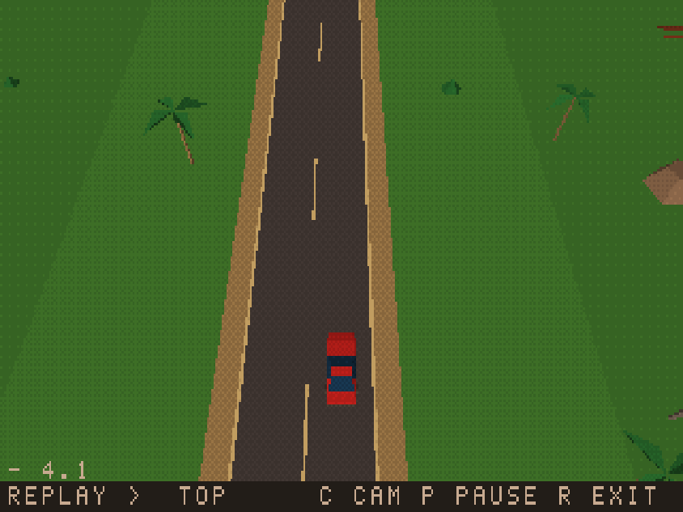 | |
| Replay of the last minute with four cameras | |

## Features

- **The route:** about 40 km from the coast:
  - over a snowy pass and through a red-rock canyon;
  - through redwoods, suburbs, along a mountain lake and down the highway;
  - into the desert.
- **Sections and branches:** six sections, each ending at a gas station with split times, a route map and a choice of the time of day for the next section. Two branches, including a gravel shortcut.
- **Four fictional cars:**

  | Car | Character |
  |---|---|
  | Vektor GT | wedge coupé, all-rounder |
  | Aurora MR | mid-engine, fastest, nervous at the limit |
  | Breeze R | light roadster, best in corners |
  | Kestrel S | sports sedan, stable, sure-footed in the rain |

- **Physics:** torque curves, five gears (automatic or manual), a bicycle tyre model with slides you can catch, grip that depends on the surface and the weather.
- **Traffic and rival:** two-way traffic, and an AI rival with three difficulty levels that stops at every station too.
- **Police:** radar traps, a radar detector, chases with flashing beacons and a siren with Doppler shift. Each stop prints a citation and adds a time penalty; the third stop ends the race.
- **Time of day and weather:** day, sunset and night, with headlights, street lamps and police beacons lighting the scene in palette space. Rain (less grip, wipers) and fog.
- **Cameras:** cockpit (with a rear-view mirror), chase, top and roadside, plus a 60-second replay with rewind.
- **Sound:** original music (menu, driving, results) and effects synthesized live with FM in the Web Audio API. Separate volume settings for music and effects.
- **Menus and settings:**
  - title screen with palette color cycling;
  - record table with name entry;
  - key and gamepad remapping;
  - touch controls;
  - km/h or mph;
  - 640×400 enhanced mode;
  - a 15 FPS "historical" mode (F3).

## Controls

| Action | Keyboard | Gamepad |
|---|---|---|
| Throttle / brake | ↑ / ↓ or W / S | RT / LT (or A / B) |
| Steer | ← → or A D | left stick, D-pad |
| Gear up / down (manual gearbox) | E / Q | RB / LB |
| Camera | C | Y |
| Look back | V | R3 |
| Replay | R | Back |
| Horn | H | L3 |
| Pause | Esc or P | Start |
| Mute | M | |

Driving keys can be remapped on the CONTROLS screen (title and pause menus). On phones, on-screen buttons appear after the first touch; the game asks for landscape orientation. The audio starts after the first key press, click or touch.

## Running locally

Requirements:

- a browser with WebGL2;
- Node.js 18+ (only for the tests and the build; there are no npm packages);
- any static HTTP server (ES modules do not load from `file://`).

```bash
python3 -m http.server 8080
# game:         http://localhost:8080/index.html
# render tests: http://localhost:8080/tests/render.html

node tools/test.mjs    # logic tests (node:assert)
node tools/build.mjs   # single-file build: dist/roadline91.html, also works from file://
```

Useful URL parameters:

| Parameter | Effect |
|---|---|
| `?race=1` | start racing right away with the saved settings |
| `?section=4` | start at section 4 |
| `?car=1` | choose the car (0–3) |
| `?time=night` | time of day: `day`, `sunset`, `night` |
| `?weather=rain` | weather: `clear`, `rain`, `fog` |
| `?gearbox=manual` | manual gearbox |
| `?units=mph` | mph units |
| `?res=2` | 640×400 enhanced mode |
| `?debug=1` | debug overlay (FPS, triangles, draw calls) |
| `?rawpal=1` | show the palette index buffer as grayscale |
| `?wire=1` | wireframe mode |
| `?god=1` | no crashes, no police |
| `?mute=1` | audio muted |

More parameters and the full technical specification are in [CLAUDE.md](CLAUDE.md).

## How it works

1. **3D passes into an index buffer.** Every 3D pass renders into an `R8UI` 320×200 texture holding palette indices. The palette is 16 ramps of 16 brightness levels.
2. **Dithering in index space.** The world shader computes one brightness level per face. Brightness, fog, headlights and street lamps are all quantized with a 4×4 Bayer matrix in the index buffer's own pixel grid, so nothing is ever blended outside the palette.
3. **CPU overlay.** The cockpit, HUD, menus, raindrops and the cracked windshield are drawn on the CPU into a 320×200 byte overlay.
4. **Present pass.** A final pass combines the overlay with the world indices and looks them up in a 256×1 palette texture. It scales the picture into a 4:3 letterbox with nearest-neighbour sampling.
5. **Palette changes.** Time of day, zones, weather and the title-screen color cycling all work by changing palette colors, never indices.
6. **Assets in code.** Models are plain data (lists of vertices and faces) built into non-indexed vertex arrays, kept within strict low-poly budgets. The music and the font are defined in code too.

The project was developed in ten stages; their scope, the rules and the known issues are in [CLAUDE.md](CLAUDE.md) and [CHANGELOG.md](CHANGELOG.md).

## Project layout

```
src/
  main.js, config.js, storage.js
  engine/   loop, input (keyboard, gamepad, touch, remapping), math, RNG, spatial grid
  gfx/      WebGL2 renderer, palette, overlay, font, shaders (GLSL in template strings)
  world/    track, branches, terrain, scenery, chunks, validator
  vehicle/  physics, drivetrain, car specifications
  ai/       traffic, rival, police
  game/     collisions, restarts, replay, rain overlay
  camera/, cockpit/, audio/, models/, data/, state/ (screens)
tools/      build.mjs, test.mjs, golden render images (.bin)
tests/      render.html – browser render tests against the goldens
site/       landing page of the GitHub Pages site
```

## Status and known issues

- **Testing so far.** All features are implemented. They were tested with the logic tests, the render tests and in headless Chromium with a software renderer.
- **Not yet verified.** Performance on real GPUs and phones, and gamepad and touch controls on physical devices.
- **Full list.** See the "Known issues" section at the top of [CHANGELOG.md](CHANGELOG.md).

## License

Copyright (C) 2026 the ROADLINE '91 authors.

This program is free software: you can redistribute it and/or modify it under the terms of the GNU Affero General Public License as published by the Free Software Foundation, either version 3 of the License, or (at your option) any later version. See [LICENSE](LICENSE).

All cars, places, companies and music in the game are fictional and original.
